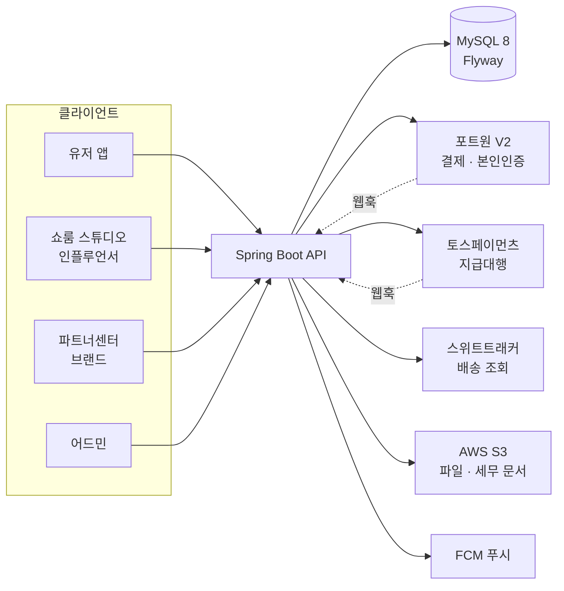
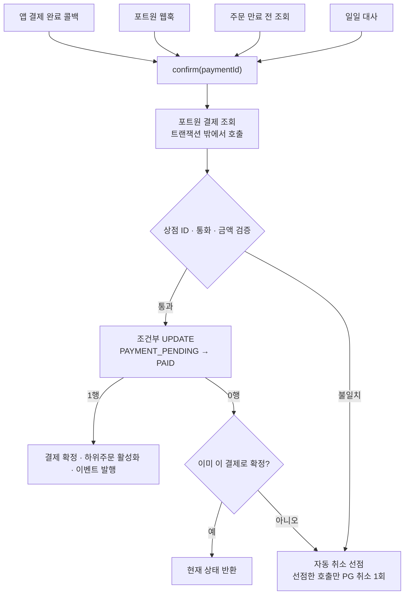
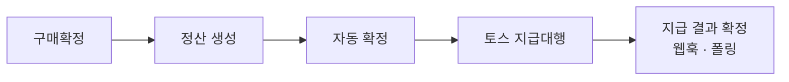
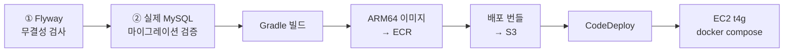

# ShowRoomz Backend

인플루언서 공동구매 커머스 **쇼룸즈(ShowRoomz)** 의 백엔드 서버입니다.

인플루언서가 공동구매를 열고, 브랜드가 상품을 공급하고, 구매자가 주문하는 플랫폼에서
**주문 · 결제 · 배송 · 클레임 · 정산 · 지급**까지 커머스 전 과정을 하나의 Spring Boot 서버가 담당합니다.

- 단국대학교 창업지원단 창업동아리 · 3인 창업팀
- 출시 준비 중

**API 문서 (Swagger)**: https://api.showroomz.shop/swagger-ui/index.html
**시연 영상**: https://www.youtube.com/watch?si=RIisrhyNu1J3Cakk&v=ml0Lpiww7lA&feature=youtu.be
<br>

## 목차

- [서비스 구성](#서비스-구성)
- [기술 스택](#기술-스택)
- [시스템 구성](#시스템-구성)
- [주문부터 정산까지](#주문부터-정산까지)
- [주요 설계](#주요-설계)
- [배포](#배포)
- [테스트](#테스트)
- [패키지 구조](#패키지-구조)
- [로컬 실행](#로컬-실행)
- [설계 문서](#설계-문서)

<br>

## 서비스 구성

| 클라이언트 | 사용자 | API 패키지 |
|---|---|---|
| 유저 앱 | 구매자 | `api.app` |
| 쇼룸 스튜디오 | 인플루언서 | `api.creator` |
| 파트너센터 | 브랜드(판매자) | `api.seller` |
| 어드민 | 운영자 | `api.admin` |

웹훅 수신 등 공용 API는 `api.common`에 있습니다.

<br>

## 기술 스택

| 구분 | 사용 기술 |
|---|---|
| Language · Framework | Java 21, Spring Boot 3.5, Spring Security (JWT · OAuth2), Spring Data JPA, QueryDSL |
| Database | MySQL 8, Flyway |
| 외부 연동 | 포트원 V2 (결제 · 웹훅 · 본인인증), 토스페이먼츠 지급대행, 스위트트래커 (배송 조회), AWS S3, FCM |
| 문서 · 파일 | Springdoc OpenAPI (Swagger), Apache POI (발주서 · 송장 엑셀), Playwright (계약서 PDF) |
| 인프라 · 배포 | Docker, GitHub Actions, Amazon ECR · S3 · CodeDeploy, EC2 (t4g, ARM64) |
| 모니터링 | Sentry, Discord 배포 알림 |

<br>

## 시스템 구성



### 규모 (2026.10 기준)

| 항목 | 수치 |
|---|---|
| API 엔드포인트 | 530+ |
| JPA 엔티티 | 149 |
| Flyway 마이그레이션 | 215 |
| 테스트 | 테스트 클래스 381 · 테스트 메서드 3,600+ |
| 정기 배치 작업 | 30+ (대사 · 만료 · 배송 조회 · 정산 · 지급 등) |

<br>

## 주문부터 정산까지

| 단계 | 내용 |
|---|---|
| 1. 주문 생성 | 옵션별 재고 예약(조건부 UPDATE), 멱등키로 중복 주문 차단 |
| 2. 결제 확정 | 포트원 V2 결제 조회 결과로만 확정, 웹훅 · 일일 대사로 누락 보정 |
| 3. 발주 · 출고 | 결제 시 하위주문 생성, 발주서 엑셀 다운로드 · 송장 엑셀 일괄 업로드 |
| 4. 배송 | 스위트트래커 배송 조회 배치, 처리 지연 자동 알림 |
| 5. 구매확정 · 클레임 | 취소 · 반품 · 교환 처리, 환불 큐로 부분 환불 집행 |
| 6. 정산 · 지급 | 정산 생성 · 자동 확정, 토스 지급대행, 환불 차감 회수 |

모든 단계의 상태 전이를 **조건부 UPDATE**로 정의해, 중복 호출이나 재시도가 와도 결과는 한 번만 반영되도록 했습니다.

<br>

## 주요 설계

### 1. 결제 확정 — 네 갈래 요청, 하나의 `confirm`

앱 결제 완료 콜백 · 포트원 웹훅 · 주문 만료 전 조회 · 일일 대사가 모두 같은 `confirm(paymentId)`를 호출합니다.



- 앱이 보낸 결제창 결과는 로그용 힌트로만 쓰고, **확정은 포트원 조회 결과만 신뢰**합니다.
- 외부 HTTP 호출은 트랜잭션 밖에서 하고, 상태 전이는 짧은 트랜잭션의 조건부 UPDATE로만 합니다.
- 경합은 예외가 아니라 **반환 행 수(0/1)** 로 판단합니다. 동시에 두 요청이 와도 1행을 얻는 쪽은 하나뿐입니다.

```java
// OrderRepository.markPaid (요약)
@Query("UPDATE Order o SET o.status = PAID, o.paidPaymentId = :paymentId, o.paidAt = :paidAt "
     + "WHERE o.id = :orderId AND o.status = PAYMENT_PENDING")
int markPaid(Long orderId, String paymentId, LocalDateTime paidAt);
```

관련 코드: [`PaymentConfirmService`](src/main/java/showroomz/api/app/order/service/PaymentConfirmService.java) · [`PaymentTransitions`](src/main/java/showroomz/api/app/order/service/PaymentTransitions.java) · [`OrderRepository`](src/main/java/showroomz/domain/order/repository/OrderRepository.java)

### 2. 웹훅 수신과 일일 대사

**웹훅**

- 원문 바이트 그대로 서명을 검증합니다(HMAC-SHA256). JSON을 먼저 파싱하면 공백 · 순서가 바뀌어 서명이 맞지 않기 때문입니다.
- `webhookId` 유니크 이벤트 행으로 중복 수신을 막습니다.
- 일시 장애는 500으로 응답해 포트원이 재전송하게 하고, 모르는 결제 · 관심 없는 이벤트는 200으로 끝냅니다.

**일일 대사** — 웹훅과 콜백은 모두 "요청이 서버에 도달했다"를 전제하므로, 매일 전날 결제를 포트원 목록과 대조하는 배치를 마지막 안전망으로 둡니다.

| 어긋남 유형 | 처리 |
|---|---|
| 포트원 결제완료 · 우리 미반영 | 이슈 기록 후 `confirm` 재호출로 수렴 |
| 포트원 취소 · 우리 결제완료 | 이슈 기록 후 `confirm` 재호출로 수렴 |
| 금액 불일치 | 이슈 기록 · Sentry 경보 |
| 우리 결제완료 · 포트원에 없음 | 이슈 기록 · Sentry 경보 |

대사 배치의 자동 수정은 **`confirm` 재호출뿐**입니다. 배치가 상태를 직접 쓰면 두 경로가 서로를 고치는 루프가 생기기 때문입니다. 같은 결제 · 유형의 이슈는 매일 새로 쌓지 않고 갱신합니다.

관련 코드: [`PaymentWebhookService`](src/main/java/showroomz/api/common/payment/service/PaymentWebhookService.java) · [`PortOneWebhookVerifier`](src/main/java/showroomz/global/payment/portone/PortOneWebhookVerifier.java) · [`PaymentReconciliationService`](src/main/java/showroomz/api/app/order/service/PaymentReconciliationService.java)

### 3. 결과를 모를 때도 상태로 남기기

외부 호출의 결과를 모르는 순간을 예외로 끝내지 않고, 다음 실행이 이어받을 수 있는 상태로 저장합니다.

| 상황 | 처리 |
|---|---|
| 결제 취소 요청 후 응답 없음 | `CANCEL_REQUESTED`로 두고 지수 백오프로 재조회, 상한 도달 시 `CANCEL_FAILED` 전환 후 운영자 경보 |
| 승인 진행 중에 주문 만료 시각 도래 | 만료를 5분씩 최대 3회 미루고 다시 확인 |
| 주문 만료 · 취소 시 재고 복원 | 주문당 1회 — `stock_released_at`을 조건부 UPDATE로 선점한 쪽만 복원 |
| 결제 금액 불일치 | 롤백 대신 `CANCELLED_MISMATCH`로 남기고 Sentry 경보 |
| 지급대행 요청 결과 모름 | 그 건만 `REQUESTED`로 두고 웹훅 · 폴링이 확정, 같은 멱등 키로 재시도해 중복 지급 없음 |

### 4. 재고와 동시성

공동구매는 짧은 시간에 주문이 몰리기 때문에, 재고 차감을 조건부 UPDATE 한 번으로 처리합니다.

```java
// ProductVariantRepository.reserveStock
@Query("UPDATE ProductVariant v SET v.stock = v.stock - :quantity "
     + "WHERE v.variantId = :variantId AND v.stock >= :quantity")
int reserveStock(Long variantId, int quantity);   // 0행 = 재고 부족 → 주문 전체 롤백
```

- 한 주문의 옵션별 수량을 합산한 뒤 `variant_id` 오름차순으로 차감합니다. 잠금 순서를 고정해 데드락을 막습니다.
- 같은 멱등키로 동시에 들어온 주문은 1건만 생성됩니다.
- 공구 상태 변경은 공구 행을 `PESSIMISTIC_WRITE`로 잠근 뒤, 권한 판정과 실행을 한 트랜잭션에서 처리합니다(잠금 순서: 공구 → 공구 게시물 → 하위 테이블).

동시성은 통합 테스트로 확인합니다([`OrderCheckoutIntegrationTest`](src/test/java/showroomz/api/app/order/OrderCheckoutIntegrationTest.java)).

| 시나리오 | 결과 |
|---|---|
| 재고 1개에 서로 다른 사용자 주문 2건 동시 요청 | `201` / `400`, 남은 재고 0, 주문 1건 |
| 같은 멱등키 주문 2건 동시 요청 | `201` / `201`, 주문 1건, 재고 1개만 차감 |

### 5. 정산 · 지급대행 · 차감



- **산식은 한 클래스에서** — 정산 · 성과 · 조정 미리보기 화면이 모두 [`SettlementCalculator`](src/main/java/showroomz/domain/settlement/service/SettlementCalculator.java)를 거쳐 같은 숫자를 봅니다. 원 단위 절사 규칙을 한 곳에서 관리하고, 상태가 없어 스프링 없이 단위 테스트합니다.
- **지급대행은 건별로** — 수취자 1명당 지급 요청 1건입니다. 묶음 요청은 한 건만 실패해도 전체가 실패해 쓰지 않았습니다. 요청 본문은 JWE(A256GCM)로 암호화하고, 요청 시각에 따라 당일 또는 다음 영업일로 지급합니다([`TossSettlementPayoutGateway`](src/main/java/showroomz/global/payment/settlement/toss/TossSettlementPayoutGateway.java)).
- **환불은 다음 정산에서 회수** — 정산 생성 뒤 발생한 환불은 이미 만든 정산 금액을 고치지 않고(스냅샷), 브랜드와 인플루언서 각자의 다음 정산에서 따로 차감합니다([`SettlementClawbackService`](src/main/java/showroomz/domain/settlement/service/SettlementClawbackService.java)).


## 배포



`main` 브랜치에 push하면 [GitHub Actions](.github/workflows/deploy.yml)가 위 순서로 배포합니다. AWS 인증은 OIDC로 하며(장기 액세스 키 미사용), 결과는 Discord로 알립니다.

검토되지 않은 Flyway 마이그레이션 파일 때문에 배포 장애가 반복되어, 빌드 전에 두 단계 게이트를 두었습니다.

1. **무결성 검사** — push 범위에서 기존 마이그레이션 파일의 수정 · 삭제가 감지되면 배포를 중단합니다(새 파일 추가만 허용).
2. **실제 MySQL 검증** — CI의 MySQL 8 서비스 컨테이너에 Flyway를 적용하고 Hibernate `validate`로 엔티티와 스키마가 맞는지 확인합니다(`./gradlew dbMigrationTest`).

<br>

## 테스트

| 명령 | 내용 |
|---|---|
| `./gradlew test` | 단위 · 통합 테스트 (H2 MySQL 호환 모드, 계약서 PDF 테스트 제외) |
| `./gradlew integrationTest` | `@Tag("integration")` 테스트만 실행 |
| `./gradlew dbMigrationTest` | 실제 MySQL에 Flyway 적용 + Hibernate validate (배포 파이프라인에서 실행) |
| `./gradlew installContractChromium contractPdfTest` | 실제 Chromium으로 계약서 PDF · 한글 폰트 · 서명 페이지 검증 |

주요 시나리오 통합 테스트

| 시나리오 | 테스트 |
|---|---|
| 계약 체결부터 정산 지급까지 한 거래 전체 | [`FullFlowEndToEndIntegrationTest`](src/test/java/showroomz/api/scenario/FullFlowEndToEndIntegrationTest.java) |
| 주문 → 결제 → 환불 | [`OrderToRefundScenarioIntegrationTest`](src/test/java/showroomz/api/scenario/OrderToRefundScenarioIntegrationTest.java) |
| 취소 · 반품 · 교환 클레임 사이클 | [`OrderClaimCycleScenarioIntegrationTest`](src/test/java/showroomz/api/scenario/OrderClaimCycleScenarioIntegrationTest.java) |
| 정산 ↔ 토스 지급대행 연동 경계 | [`SettlementTossSeamScenarioIntegrationTest`](src/test/java/showroomz/api/scenario/SettlementTossSeamScenarioIntegrationTest.java) |

외부 PG · 지급대행은 Fake 게이트웨이로 대체해 실패 · 지연 응답을 재현합니다.

<br>

## 패키지 구조

```
showroomz
├── api                 # 역할별 API — {controller, docs, dto, service}
│   ├── app             #   유저(구매자)
│   ├── creator         #   인플루언서
│   ├── seller          #   브랜드
│   ├── admin           #   운영자
│   └── common          #   공용 (웹훅 수신 등)
├── domain              # 도메인별 entity · repository · type (+ service)
│   ├── order  payment  settlement  groupbuy  product  ...
└── global              # 설정, 결제 · 지급 · 배송 게이트웨이, 스케줄러, 공통 예외
```

Swagger 문서 어노테이션은 `XxxControllerDocs` 인터페이스에 두고, 컨트롤러는 이를 구현해 매핑만 갖습니다.

<br>

## 로컬 실행

**요구 사항**: JDK 21, MySQL 8

```bash
# 1. MySQL 실행
docker run -d --name showroomz-mysql -p 3306:3306 \
  -e MYSQL_ROOT_PASSWORD=root -e MYSQL_DATABASE=showroomz \
  mysql:8.0 --character-set-server=utf8mb4 --collation-server=utf8mb4_unicode_ci
```

```properties
# 2. 프로젝트 루트에 .env 작성 (예시)
DB_URL=jdbc:mysql://localhost:3306/showroomz?serverTimezone=Asia/Seoul&characterEncoding=UTF-8
DB_USERNAME=root
DB_PASSWORD=root
TOKEN_SECRET=<JWT 서명 키>

# 외부 연동 없이 실행할 때
PORTONE_ENABLED=false            # Fake 결제 게이트웨이 사용
FCM_ENABLED=false
DELIVERY_TRACKER_ENABLED=false
SETTLEMENT_PAYOUT_MODE=SIMULATED # 지급을 즉시 완료로 처리
```

```bash
# 3. 실행 (기본 프로필: local, 기동 시 Flyway 마이그레이션 적용)
./gradlew bootRun
```

- 로컬 Swagger UI: `http://localhost:8080/swagger-ui/index.html` (운영: https://api.showroomz.shop/swagger-ui/index.html)
- 그 밖의 환경 변수(AWS S3, 메일, Sentry 등)는 [`application.yml`](src/main/resources/application.yml)을 참고하세요.

<br>

## 설계 문서

기능마다 **BE 설계서 → 테스트 시나리오 문서 → 구현** 순서로 진행했고, 문서는 [`dev/`](dev) 에 있습니다.
